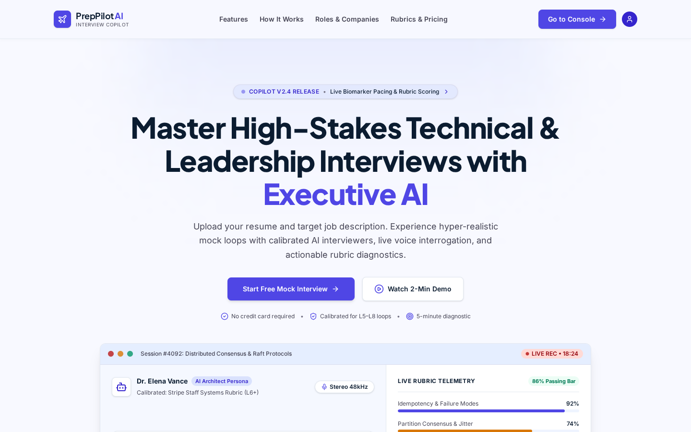
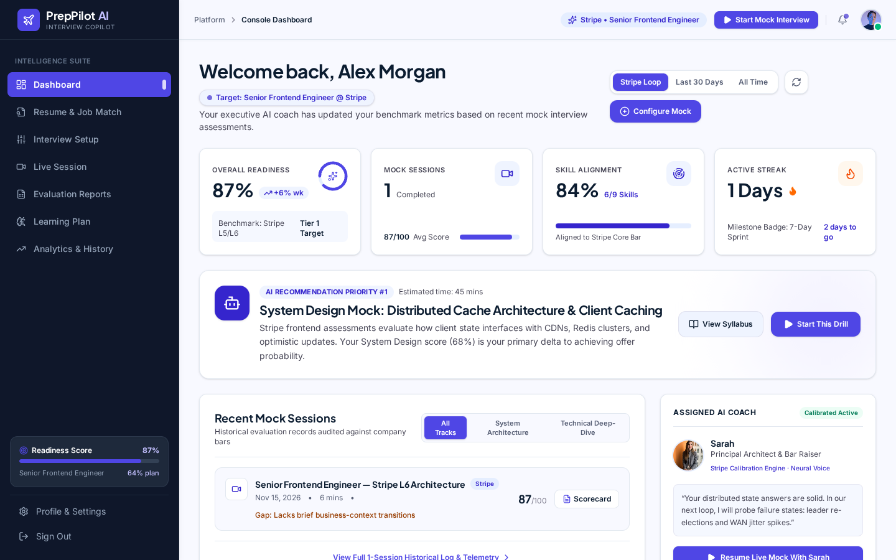
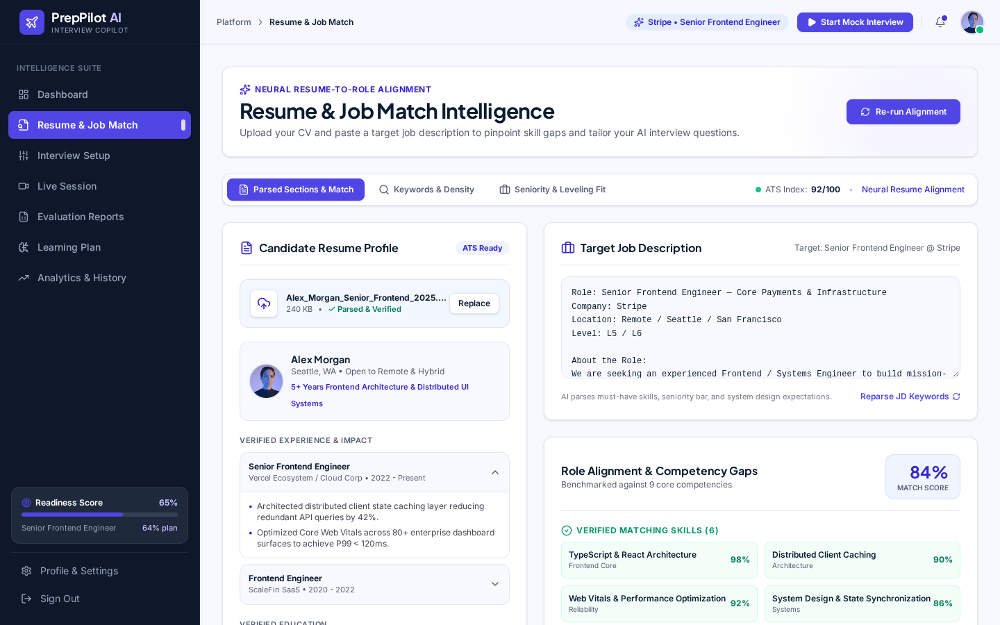
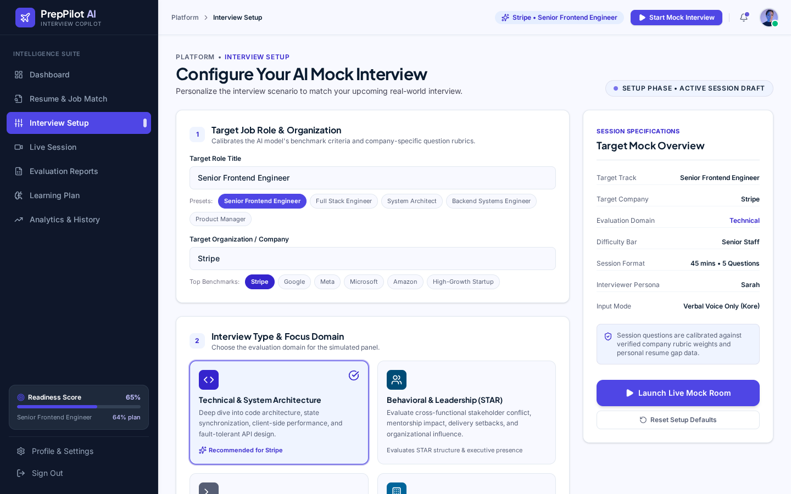
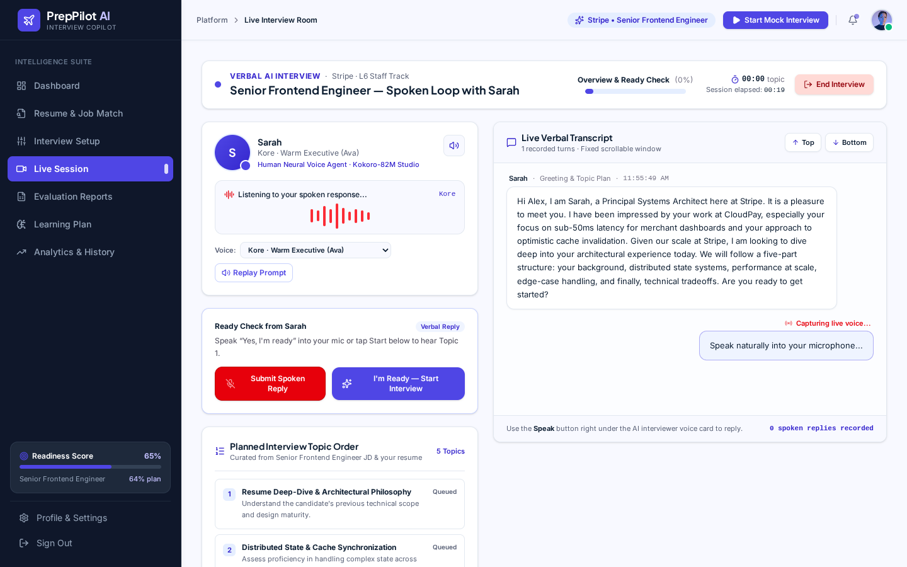
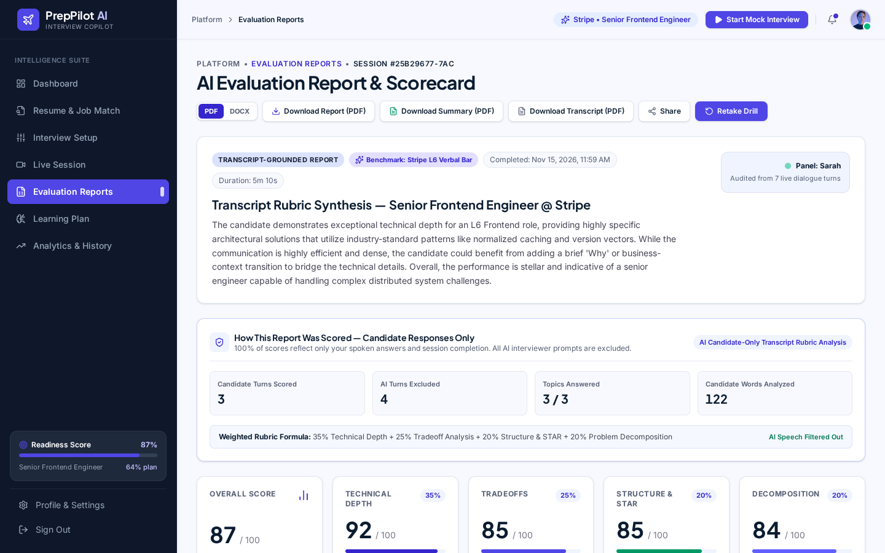
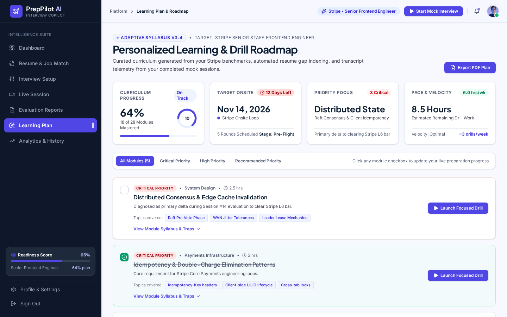
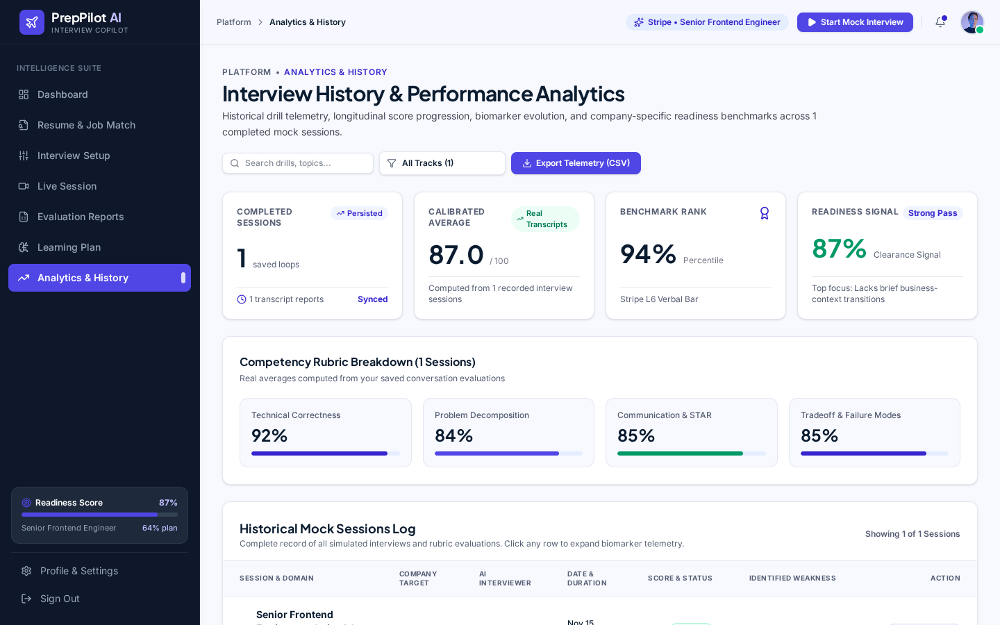
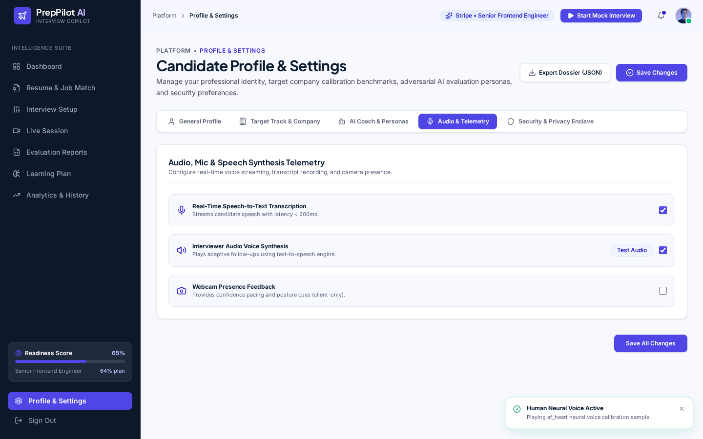

# PrepPilot AI — Adaptive Verbal Interview Simulator & Career Intelligence Suite

> **Full-stack AI-powered technical & leadership interview platform featuring real-time Kokoro-82M human neural voice agents, resume-and-JD topic planning, live scrollable transcripts, strict candidate-only rubric scoring, formatted PDF/DOCX exports, and persistent candidate workspaces.**


---

## Output Showcase

### 1. Landing Experience & Executive Hero


### 2. Candidate Readiness Dashboard


### 3. Resume & Job Description Gap Intelligence


### 4. Verbal Interview Setup & Voice Calibration


### 5. Live Verbal Interview Room (Human Neural Voice + Scrollable Transcript)


### 6. Candidate-Only Evaluation Scorecard & PDF/DOCX Exports


### 7. Adaptive Learning Plan & Drill Roadmap


### 8. Longitudinal Analytics & Session History


### 9. Profile Settings, Custom Avatar Upload & Neural Audio Calibration


---

## Key Capabilities

### Human-Sounding Neural Voice Agents (`Kokoro-82M` + Fallback Pipeline)
- **Zero-robotic in-process neural speech**: Integrates **`kokoro-js` (`onnx-community/Kokoro-82M-v1.0-ONNX`)** directly inside the Node.js backend, generating crisp 24kHz WAV human speech with natural pacing and pre-warmed startup—no external TTS API quota bottlenecks.
- **5 Selectable Human Voices & Persona Matching**:
  - `Kore` (`af_heart`) — Warm Executive (`Sarah`)
  - `Zephyr` (`af_bella`) — Crisp Analytical (`Dr. Elena Vance`)
  - `Charon` (`am_michael`) — Grounded Director Baritone (`Marcus Reed`)
  - `Puck` (`am_puck`) — Collaborative Engineering Lead (`David Chen`)
  - `Fenrir` (`am_adam`) — Confident Bar-Raiser
- **Pipelined Sentence Chunking**: Splits long interviewer greetings into natural sentence chunks with background prefetching so the first phrase begins speaking in ~2.5 seconds while subsequent sentences stream seamlessly.
- **Multi-tier resilience**: Falls back automatically across Microsoft Edge Neural Voices (`@travisvn/edge-tts`), Gemini Neural TTS, and natural browser speech synthesis if an upstream voice service is unavailable.

### Verbal-Only Adaptive Interview Orchestrator
- **Pre-Session Topic Planning**: Reviews the candidate's target role, Job Description (JD), and parsed resume to construct a numbered **Planned Interview Topic Order**.
- **Natural Greeting & Ready Check**: Greets the candidate by name, outlines the exact agenda, asks whether they are ready to start, and transitions seamlessly into Topic 1 upon verbal confirmation (e.g., *"Yes, I'm ready"*) or one-tap confirmation.
- **Mobile-Ergonomic Spoken Controls**: **Click to Speak / Submit Spoken Reply** controls are pinned directly underneath the AI interviewer voice card so mobile/Android candidates never have to scroll to speak.
- **Fixed-Height Scrollable Transcript Window**: Clean chat-style live transcript with **Top** and **Bottom** quick-scroll controls tracking AI prompts and candidate spoken replies.

### Strict Candidate-Only Evaluation Engine & Real PDF/DOCX Exports
- **Candidate-Only Transcript Auditing**: Excludes all AI interviewer prompts, greetings, and scaffolding—scoring **exclusively candidate spoken turns** across four independently evaluated pillars:
  - **Technical Depth (`35%`)**
  - **Tradeoff & Failure-Mode Analysis (`25%`)**
  - **Communication & STAR Structure (`20%`)**
  - **Problem Decomposition (`20%`)**
- **Calibrated Penalization & Real Differentiation**: Vague, one-line, evasive (*"I don't know"*), or empty responses receive genuinely low scores (`0–14`), while structured engineering answers earn granular criterion feedback, missing concept callouts, and model exemplar answers.
- **Production Exports (`jsPDF` + `docx`)**: Download formatted **Full Evaluation Reports**, **Executive Summaries**, and **Conversation Transcripts** as either **PDF** or **Word DOCX** files.

### Persistent Accounts, Custom Avatars & Dual-Layer Storage
- **Email/Password, Google (Gmail), and GitHub Auth**: Scrypt-salted password hashing + OAuth linkage stored in `user_accounts` and `profiles`.
- **Persistent Custom Profile Images**: Upload PNG/JPEG/WebP/GIF profile photos (resized and persisted server-side) that stay synced across every login and sidebar/profile view.
- **Dual-Layer Cloud + Local Enclave Database**: Connects to PostgreSQL via **Supabase** when credentials are configured, with automatic fallback to a persistent server-side JSON enclave (`.data/enclave_db.json`) so candidate profiles, avatars, resumes, sessions, and evaluation reports always survive restarts.

---

## Architecture Overview

```text
PrepPilot AI
├── server.ts                    # Express server + Vite middleware + /api/db/*, /api/auth/*, /api/ai/*
├── server/
│   ├── aiInterviewer.ts         # Kokoro-82M neural TTS, Gemini orchestration, topic planner, candidate-only rubric evaluator
│   ├── enclaveDb.ts             # Persistent server-side JSON database & multi-table store
│   ├── authCrypto.ts            # Scrypt password hashing & verification
│   └── *.test.ts                # Server & AI orchestrator unit tests (node:test)
├── src/
│   ├── pages/                   # Landing, Login, Register, Dashboard, ResumeMatch, Setup, LiveRoom, Reports, LearningPlan, Analytics, Settings
│   ├── hooks/
│   │   └── useVoiceAgent.ts     # Pipelined neural TTS playback + Web Speech / MediaRecorder voice capture
│   ├── context/
│   │   ├── AuthContext.tsx      # Session state, email/Google/GitHub auth, avatar updates
│   │   └── AppContext.tsx       # Candidate state hydration, interview lifecycle & report persistence
│   ├── utils/
│   │   ├── interviewFlow.ts     # Ready-check intent detection, speech chunking, voice labels
│   │   ├── pdfExport.ts         # Formatted jsPDF & docx Full Report, Summary, and Transcript generators
│   │   └── *.test.ts            # Scoring, ATS, avatar, and voice flow unit tests
│   └── lib/
│       └── supabase.ts          # Client-safe proxy calls to /api/db/* endpoints
├── supabase/
│   ├── README.md                # Remote Supabase setup notes
│   └── migrations/              # SQL schema migrations (profiles, user_accounts, resumes, sessions, reports)
└── docs/screenshots/            # Output UI screenshots used in README
```

---

## Local Setup & Installation

### 1. Prerequisites
- **Node.js `>= 20.x`** (recommended Node 20 LTS or 22 LTS)
- **npm** (or `bun`)

### 2. Clone the Repository
```bash
git clone https://github.com/<your-username>/preppilot-ai.git
cd preppilot-ai
```

### 3. Install Dependencies
```bash
npm install
```

### 4. Configure Environment Variables
Copy `.env.example` to `.env`:
```bash
cp .env.example .env
```

Edit `.env` with your credentials:
```env
# Optional: Enables live Google Gemini question planning & AI transcript analysis
# Without this, the calibrated deterministic engine & Kokoro-82M human voice still run out of the box.
GEMINI_API_KEY="your-gemini-api-key"

# App host URL
APP_URL="http://localhost:3000"

# Optional: Supabase Cloud PostgreSQL persistence
# If omitted or unreachable, PrepPilot automatically uses its local persistent enclave (.data/enclave_db.json).
SUPABASE_URL="https://your-project-id.supabase.co"
SUPABASE_SERVICE_ROLE_KEY="your-service-role-key"
```

> **Note on Kokoro-82M Neural Voice Model:** On first startup, `kokoro-js` automatically downloads and caches the quantized `onnx-community/Kokoro-82M-v1.0-ONNX` (`q4`) voice weights locally for offline, zero-cost human voice synthesis.

### 5. Optional: Apply Supabase Database Migrations
If connecting a cloud Supabase project, apply the SQL migrations in `/supabase/migrations/` via the Supabase SQL Editor or CLI so `profiles`, `user_accounts`, `resumes`, `interview_sessions`, `interview_questions`, `candidate_answers`, `evaluation_reports`, and `learning_plans` tables are provisioned.

---

## Running & Verification Commands

| Command | Description |
| :--- | :--- |
| `npm run dev` | Starts the full-stack Express + Vite development server on **`http://localhost:3000`** |
| `npm run build` | Builds the optimized production client bundle (`dist/`) |
| `npm start` | Runs the Express server (serves `dist/` when `NODE_ENV=production`) |
| `npm run lint` | Runs strict TypeScript type-checking (`tsc --noEmit`) |
| `npx tsx --test server/*.test.ts src/**/*.test.ts` | Executes all **30** unit & integration tests using Node's test runner |

---

## API Endpoints Reference

| Endpoint | Method | Purpose |
| :--- | :--- | :--- |
| `/api/health` | `GET` | Health status & active database mode (`connected` or `local-enclave`) |
| `/api/auth/register` | `POST` | Register candidate workspace with hashed password & optional avatar |
| `/api/auth/login` | `POST` | Authenticate with email/password and hydrate saved avatar & profile |
| `/api/auth/oauth` | `POST` | Google/Gmail & GitHub account linkage |
| `/api/db/avatar` | `POST` | Save or reset custom uploaded candidate profile photo |
| `/api/db/profile`, `/api/db/resume`, `/api/db/session`, `/api/db/evaluation`, `/api/db/learning-plan` | `GET` / `POST` | User-isolated persistence across cloud PostgreSQL and local enclave |
| `/api/ai/interview/plan` | `POST` | Generates ordered interview topics & greeting overview from role, JD, and resume |
| `/api/ai/interview/respond` | `POST` | Evaluates spoken answer in real time and generates contextual follow-up or next topic |
| `/api/ai/interview/evaluate` | `POST` | Computes candidate-only weighted rubric scores and actionable improvement drills |
| `/api/ai/tts` | `POST` | Synthesizes human neural voice audio (`Kokoro-82M` WAV primary, `Edge TTS` / `Gemini TTS` fallback) |
| `/api/ai/transcribe` | `POST` | Transcribes recorded candidate microphone audio when Web Speech API is unavailable |

---

## License

Built for engineering interview preparation and academic demonstration. See package dependencies for respective open-source licenses (`kokoro-js` / Kokoro-82M Apache 2.0).
